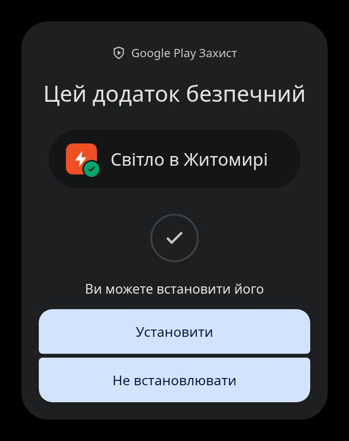
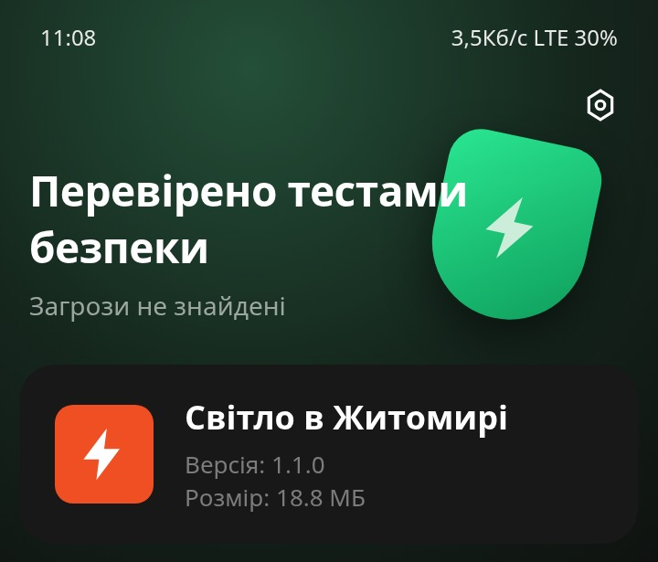
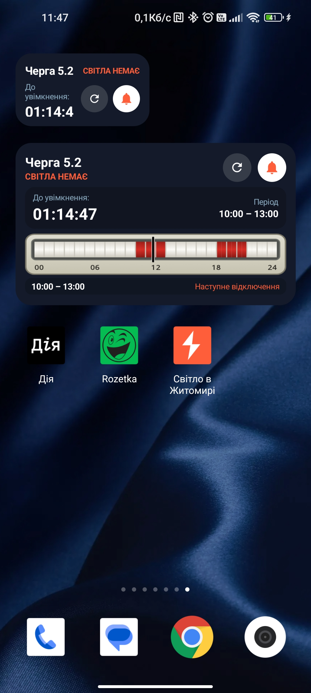
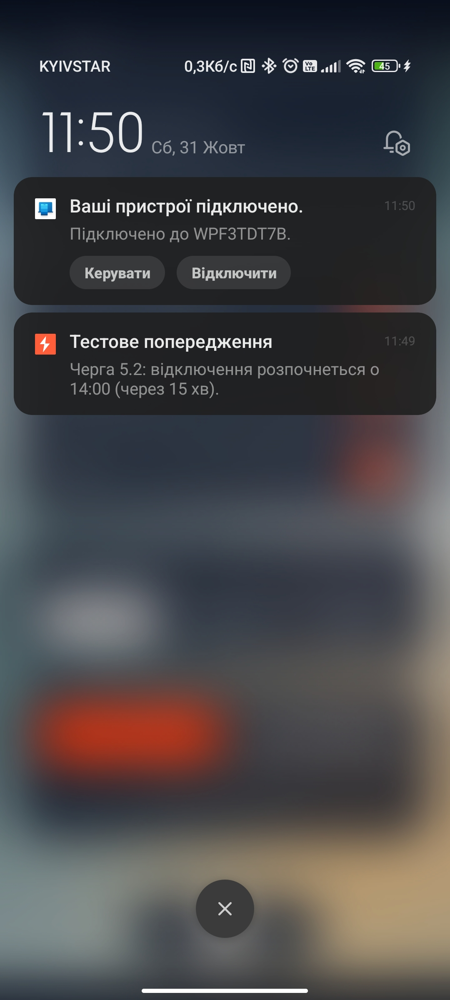
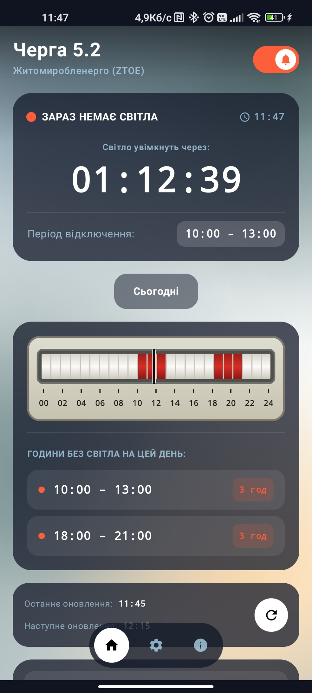
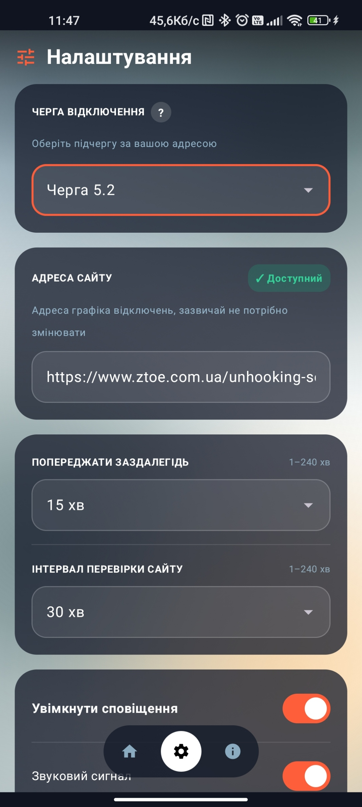
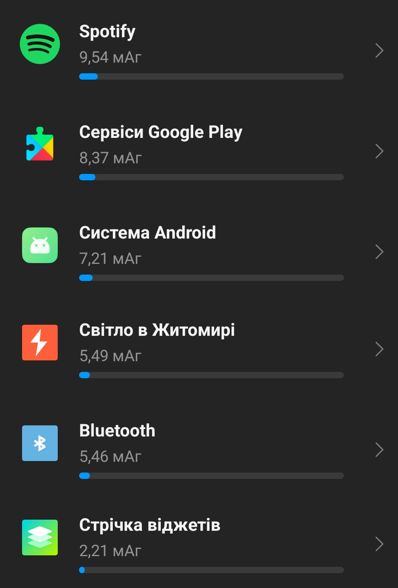

#  Світло в Житомирі

<!-- LATEST_RELEASE_START -->
## Завантажити застосунок на iPhone (iOS 17.0+)

**[Завантажити останню версію .IPA (v1.3.3)](https://github.com/IgorZaharov/iOS-ZTPreBlackoutNotification/releases/latest/download/iOS-ZTPreBlackoutNotification-unsigned.ipa)**

Як встановити:
1. Завантажте останню збірку `.ipa` із розділу Releases або GitHub Actions Artifacts.
2. Встановіть застосунок на iPhone через **TestFlight**, **AltStore**, **Sideloadly** або **Xcode / Apple Configurator**.
3. При sideload-встановленні відкрийте **Налаштування iOS → Основні → VPN і керування пристроєм** та підтвердіть довіру до профілю розробника.

Застосунок відповідає вимогам **Apple App Store Review Guidelines** та містить офіційний маніфест конфіденційності `PrivacyInfo.xcprivacy` (нульовий збір даних та відсутність трекінгу):

| Перевірка безпеки (`sec1.jpg`) | Перевірка цілісності (`sec2.jpg`) |
|:---:|:---:|
|  |  |
<!-- LATEST_RELEASE_END -->

---

Нативний iOS-застосунок (`Swift 5.10`, `SwiftUI`, `WidgetKit`), який стежить за графіком погодинних відключень електроенергії від **АТ «Житомиробленерго»** і попереджає про відключення заздалегідь. Показує, скільки лишилося до відключення (або до повернення світла), малює 24-годинну шкалу дня в стилі електролічильника САЗУ-ИТ і має інтерактивні віджети `WidgetKit` для екрана «Додому».

Дані беруться зі сторінки [ztoe.com.ua/unhooking-search.php](https://www.ztoe.com.ua/unhooking-search.php). Це неофіційний застосунок і він не пов'язаний із «Житомиробленерго».

Мобільне продовження десктопного проєкту [UABlackoutPreWarning](https://github.com/IgorZaharov/UABlackoutPreWarning).

---

## Інтерфейс застосунку (UI)

| Віджети (`UI1.jpg`) | Сповіщення (`UI2.jpg`) | Головний екран (`UI3.jpg`) | Налаштування (`UI4.jpg`) |
|:---:|:---:|:---:|:---:|
|  |  |  |  |

---

## Можливості

- **Графік для вашої черги.** Застосунок завантажує таблицю відключень, знаходить рядок вибраної черги (1.1–6.2) і виділяє періоди без світла на сьогодні та, коли він опублікований, на завтра.
- **Зворотний відлік.** Великий таймер до найближчого відключення або до відновлення живлення, плюс 24-годинна шкала доби з маркером поточного часу за київським часом (`Europe/Kyiv`).
- **Попередження заздалегідь.** Локальні сповіщення за 1–240 хвилин до відключення (за замовчуванням 15 хв), з точним календарним спрацюванням через `UNUserNotificationCenter` та `UNCalendarNotificationTrigger`. На кожен об'єднаний блок послідовних годин без світла приходить не більше одного сповіщення (`AlertRegistry`). Звук (`UNNotificationSound`) і тактильний відгук (`UIImpactFeedbackGenerator`) можна вимкнути окремо.
- **Віджет WidgetKit (`systemSmall` 2×1 та `systemMedium` 3×2).** Фон обох віджетів має 20% прозорості (`80%` непрозорості). Показує чергу, статус, таймер у форматі `HHг. MMхв.` без секунд, 24-годинну шкалу САЗУ-ИТ та наступне відключення, має інтерактивні кнопки `AppIntents` (`RefreshScheduleIntent` та `ToggleAlertsIntent`) для примусового оновлення та вмикання/вимкнення сповіщень прямо з екрана «Додому», а дотик до віджета відкриває застосунок.
- **Частота оновлення і перемальовування віджета.** Віджет оновлюється:
  1. Автоматично у фоні через `BGTaskScheduler` (`BGAppRefreshTask`, ідентифікатор `ua.blackout.prewarning.sync`) відповідно до вибраного в налаштуваннях інтервалу перевірки сайту (за замовчуванням кожні **30 хвилин**, діапазон 1–240 хв) та таймлайну `TimelineProvider`.
  2. Точно на межі кожної півгодини (`00` та `30` хвилин) та на початку і завершенні кожного періоду відключення.
  3. Миттєво при натисканні інтерактивної кнопки оновлення на самому віджеті (`WidgetCenter.shared.reloadAllTimelines()`), відкритті застосунку або зміні черги чи налаштувань.
- **Вигляд.** Нативний інтерфейс `SwiftUI` з темною палітрою Liquid Glass та плавним градієнтом часу доби (`TimeOfDayPalette`), українська й англійська мови (за замовчуванням мова системи iOS).

## Використання батареї (Battery Usage)

Застосунок спроєктовано з акцентом на енергоефективність iOS і він не має суттєвого впливу на розряд акумулятора iPhone. Посекундний таймер зворотного відліку працює лише тоді, коли застосунок активний на екрані (`scenePhase == .active`), а у фоновому режимі використовуються системні задачі `BGAppRefreshTask` та локальні тригери `UNCalendarNotificationTrigger` без постійних фонових процесів.

| Деталі використання батареї (`battery1.png`) |
|:---:|
|  |

## Вимоги

- iOS 17.0+ (iPhone)
- Доступ до інтернету та дозвіл на сповіщення (`UNUserNotificationCenter`) для завчасних попереджень.

## Збірка

Потрібні macOS 14+, Xcode 15.4+ та утиліта `XcodeGen`.

З командного рядка:

```bash
git clone https://github.com/IgorZaharov/iOS-ZTPreBlackoutNotification.git
cd iOS-ZTPreBlackoutNotification/ios

xcodegen generate
xcodebuild -project iOS-ZTPreBlackoutNotification.xcodeproj \
  -scheme ZTPreBlackout \
  -configuration Release \
  -sdk iphoneos \
  CODE_SIGNING_ALLOWED=NO build
```

GitHub Actions ([`.github/workflows/build-ipa.yml`](.github/workflows/build-ipa.yml)) автоматично запускає unit-тести, генерує `.xcodeproj` через `XcodeGen` і збирає `iOS-ZTPreBlackoutNotification-unsigned.ipa` (а також підписаний `.ipa` за наявності Apple Distribution секретів) при кожному push і pull request у `main`.

## Як це працює

1. `BackgroundSyncManager` через `ZtoeParser` (`URLSession`, кодування `Windows-1251` / `UTF-8`) завантажує сторінку `ztoe.com.ua` й витягує 48 півгодинних слотів `POWER_ON` / `POWER_OFF` для вибраної черги.
2. Послідовні слоти без світла об'єднуються в єдині неперервні блоки (`ScheduleRepository`), для яких `NotificationScheduler` планує точні календарні сповіщення (`UNCalendarNotificationTrigger`), а `AlertRegistry` гарантує відсутність дублювання.
3. Головний екран і розширення `BlackoutWidgetExtension` використовують спільний контейнер `App Group` (`group.ua.blackout.prewarning`), тому завжди показують однакові дані.
4. Усі налаштування зберігаються локально в `UserDefaults` (задекларовано в `PrivacyInfo.xcprivacy` з кодом `CA92.1`). Застосунок не збирає й нікуди не відправляє особисті дані.

## Структура репозиторію

```
ios/                         Нативний iOS-проєкт (Swift 5.10, SwiftUI, WidgetKit)
  project.yml                Специфікація XcodeGen для генерації .xcodeproj
  Shared/                    Моделі, ZtoeParser, KyivZone, ScheduleRepository, SettingsRepository, AppStrings
  ZTPreBlackout/             Головний застосунок SwiftUI, NotificationScheduler, BackgroundSyncManager, PrivacyInfo.xcprivacy
  BlackoutWidgetExtension/   Віджети WidgetKit (systemSmall, systemMedium) та інтерактивні AppIntents
  ZTPreBlackoutTests/        Модульні тести XCTest (ZtoeParserTests.swift)
  Resources/                 Локальні ресурси, аудіофайли та текстури для «Житомирської Рулетки»
src/, index.html, vite.config.ts
                             Інтерактивний веб-симулятор iPhone та інженерний стенд (React + Vite)
scripts/                     Скрипти пакування iOS-архіву
```

## Стек

Swift 5.10, SwiftUI, WidgetKit, AppIntents (iOS 17+), UserNotifications (`UNUserNotificationCenter`), BackgroundTasks (`BGTaskScheduler`), AVFoundation (`AVAudioPlayer`), CoreGraphics (`UIGraphicsImageRenderer`), XCTest, XcodeGen.

## Автор

Ігор Захаров ([@IgorZaharov](https://github.com/IgorZaharov)). Помилки й пропозиції надсилайте в [Issues](https://github.com/IgorZaharov/iOS-ZTPreBlackoutNotification/issues).
